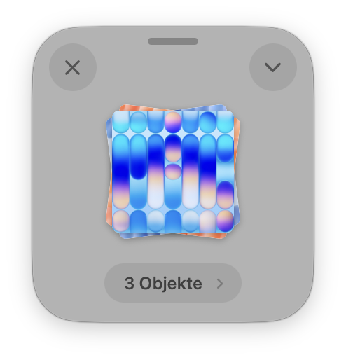

<p align="center"></p>

# DropMe

Ein kleines, privates Ablagefenster für macOS, angelehnt an Dropover. Kein Netzwerk, keine Telemetrie, kein Konto.

<p align="center"></p>

## Was es kann

- **Umschalttaste beim Ziehen** von Dateien öffnet ein schwebendes Fenster unter dem Mauszeiger. Wird nichts abgelegt, verschwindet es wieder.
- Dateien hineinlegen (auch aus mehreren Orten und als Anhang aus Mail), später gesammelt wieder herausziehen. Werden sie dabei verschoben, leert sich das Fenster von selbst.
- **Aktionsmenü** (Chevron oben rechts): Öffnen mit, Im Finder anzeigen, Schnellansicht, Teilen (AirDrop, Mail, Nachrichten, Notizen, Mehr), Aus Zwischenablage hinzufügen, Kopieren, Kopieren nach, Bewegen nach, Schnellziele, Fenster leeren.
- **Schnellziele**: Ordner mit eigenem Namen, die direkt im Menü stehen und dorthin kopieren. Gepflegt über „Einstellungen …“ im Aktionsmenü.
- **Pille** unten: Name bzw. Anzahl, ein Klick listet die einzelnen Dateien (öffnen, zeigen, entfernen).
- Tastatur: Leertaste Schnellansicht, Esc oder ⌘W schließen, ⌘C kopieren, ⌘V einfügen, Doppelklick öffnet.
- Menüleiste: Neues Fenster, Alle schließen, Beim Anmelden starten.
- `open -a DropMe <Dateien>` legt Dateien direkt in ein neues Fenster.
- Liquid Glass ab macOS 26, dezente Animationen (abgeschaltet bei „Bewegung reduzieren“), Hell- und Dunkelmodus.

## Privatsphäre

DropMe enthält keinen Netzwerkcode. Prüfen lässt sich das am Binary:

```sh
otool -L /Applications/DropMe.app/Contents/MacOS/DropMe        # kein CFNetwork, kein Network.framework
nm -u /Applications/DropMe.app/Contents/MacOS/DropMe | grep -i urlsession   # leer
```

Beim Erkennen eines Ziehvorgangs liest DropMe nur die Typen auf dem Drag-Pasteboard, nie den Inhalt.
Teilen läuft über die Dienste von macOS (AirDrop, Mail …), DropMe selbst sendet nichts.

## Installation

Per Homebrew:

```sh
brew tap wiredframe/tap
brew trust --cask wiredframe/tap/dropme
brew install --cask wiredframe/tap/dropme
```

Oder von Hand: `DropMe-<Version>.zip` unter [Releases](../../releases) laden, entpacken, `DropMe.app` nach `/Applications` ziehen.

Die App ist mit einer Developer ID signiert, aber noch nicht notarisiert. Beim ersten Start blockiert macOS sie deshalb (der Homebrew-Cask erledigt das selbst). Entweder in den Systemeinstellungen unter „Datenschutz & Sicherheit“ auf „Trotzdem öffnen“ klicken oder einmal im Terminal:

```sh
xattr -dr com.apple.quarantine /Applications/DropMe.app
```

## Bauen

```sh
./build.sh            # baut build/DropMe.app (Apple Silicon, mit Developer ID signiert, sonst ad hoc)
./build.sh --install  # zusätzlich nach ~/Applications und starten
./build.sh --zip      # zusätzlich build/DropMe-<Version>.zip, notarisiert, wenn ein notarytool-Profil „notary“ existiert
```

Voraussetzung: Mac mit Apple Silicon, Xcode bzw. Swift 5.10+, macOS 14+.

## Lizenz

MIT
